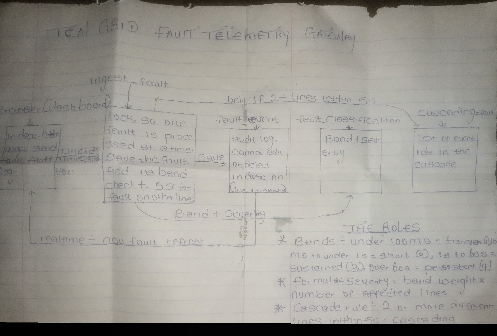
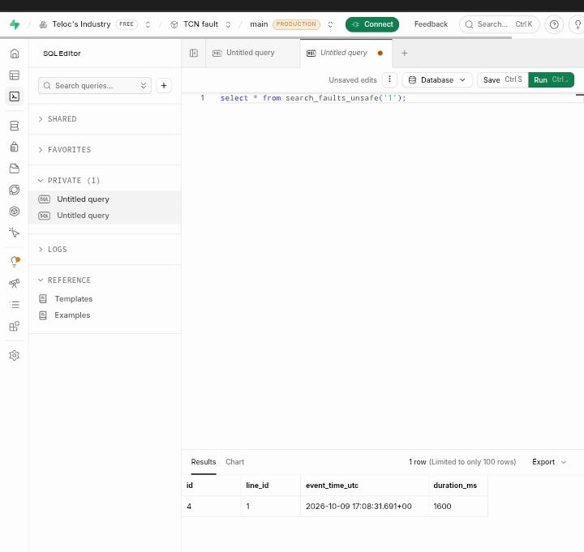
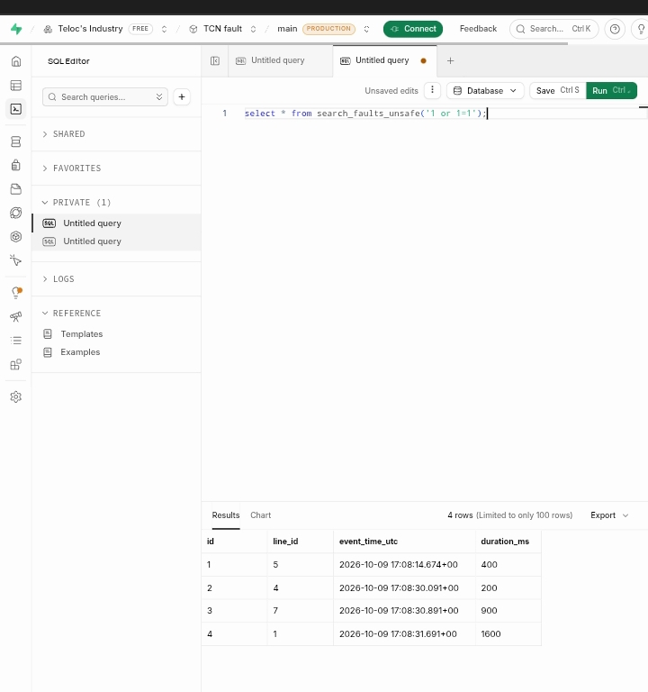
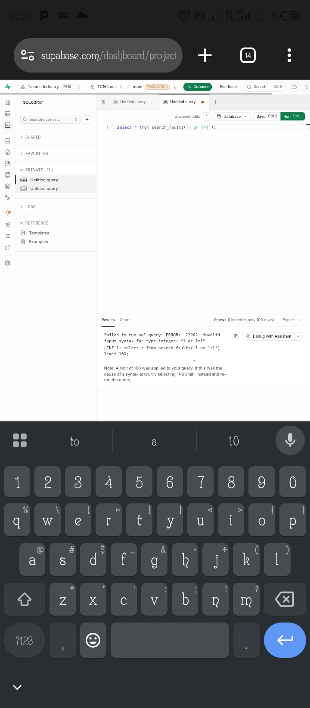

# TCN Fault Telemetry Gateway

**Live demo:** https://tcnpowerfault.netlify.app
**Repository:** https://github.com/Dr-Leo-tech/TCN_power_fault

Records faults on the transmission grid, classifies them by duration, detects cascading faults and shows grid status on a live dashboard.

## Setup
1. Create a Supabase project and run `schema.sql` in the SQL editor.
2. Put the project URL and anon key into the two constants at the top of the script in `index.html`.
3. Push to GitHub and deploy on Netlify.

## How it works
- `POST /rest/v1/rpc/ingest_fault` is the ingest endpoint (line_id, event_time, duration_ms). All times are UTC.
- Bands: transient < 100 ms, short 100 ms to under 1 s, sustained 1 s to 60 s, persistent > 60 s.
- Cascading: faults on 2 or more different lines within 5 seconds of each other.
- Severity = band weight (1 to 4) x number of affected lines.
- Faults cannot be edited or deleted (database trigger).

- ## Architecture

## Security: SQL injection
The unsafe function glued the line_id text into the query, so `1 or 1=1` returned every line's faults.
The patched function takes an integer and binds the value, so the same input is rejected.

.

## Research and citations
Add the sources you actually read here (TCN grid operations, fault types, cascading fault definition, SCADA basics), with title, publisher and date.

## Design notes
- Supabase (Postgres) used instead of a separate server and MySQL.
- A lock inside the ingest function makes cascade detection safe when faults arrive together.
- Composite index on (line_id, event_time_utc).
- The dashboard pages through the log 25 rows at a time and never loads the whole table.
